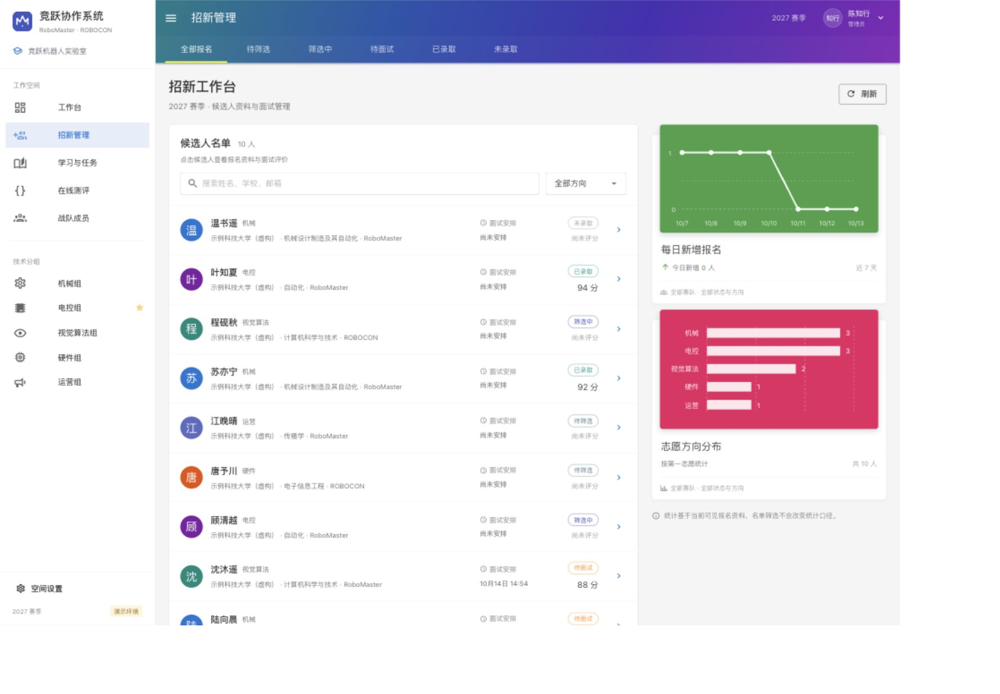

# 竞跃 · 战队协作台

**MR System** 是面向 RoboMaster / ROBOCON 高校机器人战队的招新与培养平台。第一版打通「报名 → 面试 → 录取 → 任务提交 → 导师审核」，让选人和培养共享一份成员记录。

界面参考[华南虎面试系统演示](https://www.bilibili.com/video/BV1DC4y1f7Fh/)的 Material 布局：青蓝紫渐变顶栏、黄色标签指示线、技术分组侧栏、紧凑人物名单和彩色统计卡。代码与素材独立实现，项目不隶属于上述赛事或华南虎战队。

[](https://github.com/goldenfishs/MR_system/actions/workflows/ci.yml)



另见 [工作台](docs/screenshots/dashboard-desktop.jpg)、[手机界面](docs/screenshots/dashboard-mobile.jpg)和[界面参考说明](docs/ui-reference.md)。

## 当前功能

- **工作台**：按登录身份呈现招新、审核、任务和活动记录。
- **招新管理**：注册报名、两个技术方向志愿、面试安排、面试评分与录取决策。
- **培养任务**：发布编程、文档、实机和知识测评任务，设置方向、赛队与截止时间；当前均提交说明或链接，由导师人工审核。
- **提交与审核**：提交说明、代码仓库与作品链接；保留提交版本，导师评分、通过或退回修改。
- **成员与设置**：成员列表，管理员创建导师／面试官账号，组织名称、赛季、报名开关与公告。
- **Hydro 入口**：配置已有 Hydro 实例链接。当前不创建评测、不自动判题、不同步账号或成绩。
- **服务端权限**：管理员、导师、面试官、学员四种身份；学员仅访问自己的报名和提交，面试官仅处理分配给自己的候选人。

这是可运行的首版 MVP。每人只有一份报名，暂不支持多届招新归档、自动预约名额、文件托管上传、邮件／短信投递、完整项目管理和物资财务。赛季目前是展示配置。演示数据均为虚构。

## 本地运行

需要 **Node.js 22 LTS、npm、Go 1.24+**。本地演示使用 SQLite，不需要 Docker 或 PostgreSQL。

```sh
npm --prefix frontend ci
bash scripts/dev.sh
```

打开 <http://localhost:5173>。脚本会构建并启动后端和 Vite；按 `Ctrl+C` 停止。前端代理 `/api` 到 `127.0.0.1:8080`，数据保存在被 Git 忽略的 `data/demo/`。脚本拒绝使用外部 `DATABASE_URL`，避免把演示账号写入现有数据库。

首次下载 Go 模块需要网络。也可以分别启动：

```sh
# 终端 1
cd backend
DEMO_MODE=true SESSION_SECURE=false go run .
```

```sh
# 终端 2（仓库根目录）
npm --prefix frontend run dev
```

演示账号仅在 `DEMO_MODE=true` 时初始化：

| 身份 | 邮箱 | 密码 |
| --- | --- | --- |
| 管理员 | `admin@demo.local` | `DemoAdmin!2026` |
| 导师 | `mentor@demo.local` | `DemoMentor!2026` |
| 面试官 | `interviewer@demo.local` | `DemoInterview!2026` |
| 学员 | `student@demo.local` | `DemoStudent!2026` |

演示与正式部署使用不同数据库。正式模式会拒绝已写入演示标记的数据库，关闭演示开关不会自动删除或迁移演示账号。

## 构建与检查

```sh
npm --prefix frontend run typecheck
npm --prefix frontend run build
cd backend
go vet ./...
go test ./...
CGO_ENABLED=0 go build -o mr-system .
```

在 `backend/` 目录运行后端时，默认从 `../frontend/dist` 提供构建后的前端。开发脚本和 Docker 已显式设置 `WEB_DIR`。GitHub Actions 执行前后端的检查与构建，使用临时 PostgreSQL 17 服务运行集成测试，并构建容器镜像（不发布）；上述命令也是本地验证入口。

本地真实 HTTP 闭环与重启持久化检查见 [验收记录](docs/verification.md)。

## Docker Compose 部署

仓库提供单实例 Go 服务 + 静态前端 + PostgreSQL 17 的部署定义；当前不要运行共享数据库的多个应用副本。需要 Docker Compose v2，并在应用前配置同域的 HTTPS 反向代理。首次启动：

```sh
cp .env.example .env
openssl rand -hex 24
# 编辑 .env：填写数据库密码、管理员邮箱与 12–72 字节管理员强密码。
# POSTGRES_PASSWORD 使用上一步生成的十六进制字符串。
docker compose up --build -d
docker compose logs -f app
```

应用默认只绑定宿主机 `127.0.0.1:8080`，数据库不映射外部端口。将 HTTPS 反向代理转发到该地址，并保留原始 `Host`；如代理会改写 `Host`，设置 `PUBLIC_ORIGIN=https://你的域名`。`SESSION_SECURE=true` 要求浏览器通过 HTTPS 访问，直接用 HTTP 登录不能正常保持会话。

Compose 强制关闭演示模式，要求显式提供管理员和数据库凭据。管理员变量用于首次引导，不能代替账号管理或密码轮换。首次登录后在设置中配置组织信息、报名截止时间并开启报名；在成员管理中创建导师与面试官账号。工作人员使用独立邮箱与 12–72 字节密码，已有注册账号暂不支持直接修改角色。数据库密码会嵌入连接 URI，因此此部署定义要求使用 URL 安全字符，推荐十六进制随机值。请勿提交 `.env`。

PostgreSQL 数据存于 `postgres_data` 卷；发布新版本前备份数据库，避免使用 `docker compose down -v` 删除持久化数据。项目尚未提供自动备份、自助改密、邮件找回密码和版本化数据库回滚工具。登录／注册已有基础限流；通过反向代理部署时，应按实际访问规模配置代理限流并验证备份恢复流程。

## 配置

| 变量 | 说明 | 默认值 |
| --- | --- | --- |
| `ADDR` | 后端监听地址 | `127.0.0.1:8080` |
| `DATABASE_URL` | PostgreSQL 连接 URI；为空时使用 SQLite | 空 |
| `DATA_DIR` | SQLite 数据目录 | `./data` |
| `WEB_DIR` | 构建后的前端目录 | `../frontend/dist` |
| `DEMO_MODE` | 初始化虚构账号与示例数据，仅供本地演示 | `false` |
| `ADMIN_EMAIL` | 正式环境初始管理员邮箱 | 空 |
| `ADMIN_PASSWORD` | 正式环境初始管理员密码 | 空 |
| `ADMIN_NAME` | 初始管理员显示名 | `管理员` |
| `SESSION_SECURE` | Cookie 是否仅通过 HTTPS 发送 | 本地 `false`；部署定义设置为 `true` |
| `PUBLIC_ORIGIN` | 允许的公开来源，例如 `https://team.example.com` | 空，使用同源校验 |

## 结构与协作

```text
frontend/            Vue 3 + TypeScript + Vuetify + Vite
backend/             Go HTTP API、认证、业务校验与持久化
docs/api-contract.md 接口与角色约定
docs/architecture.md 架构、数据边界与部署说明
docs/roadmap.md      后续里程碑
scripts/dev.sh       本地演示启动脚本
```

欢迎提交 Issue 和 Pull Request。问题报告请说明版本、复现步骤、预期结果与实际结果，并去除候选人个人信息和凭据。涉及权限、报名状态或提交审核的修改，请附相应后端测试；界面修改请确认桌面与窄屏布局。

本仓库独立代码使用 [MIT 许可证](LICENSE)。第三方依赖保持各自许可证。与 [Hydro](https://github.com/hydro-dev/Hydro) 交互不改变其自身许可要求。
