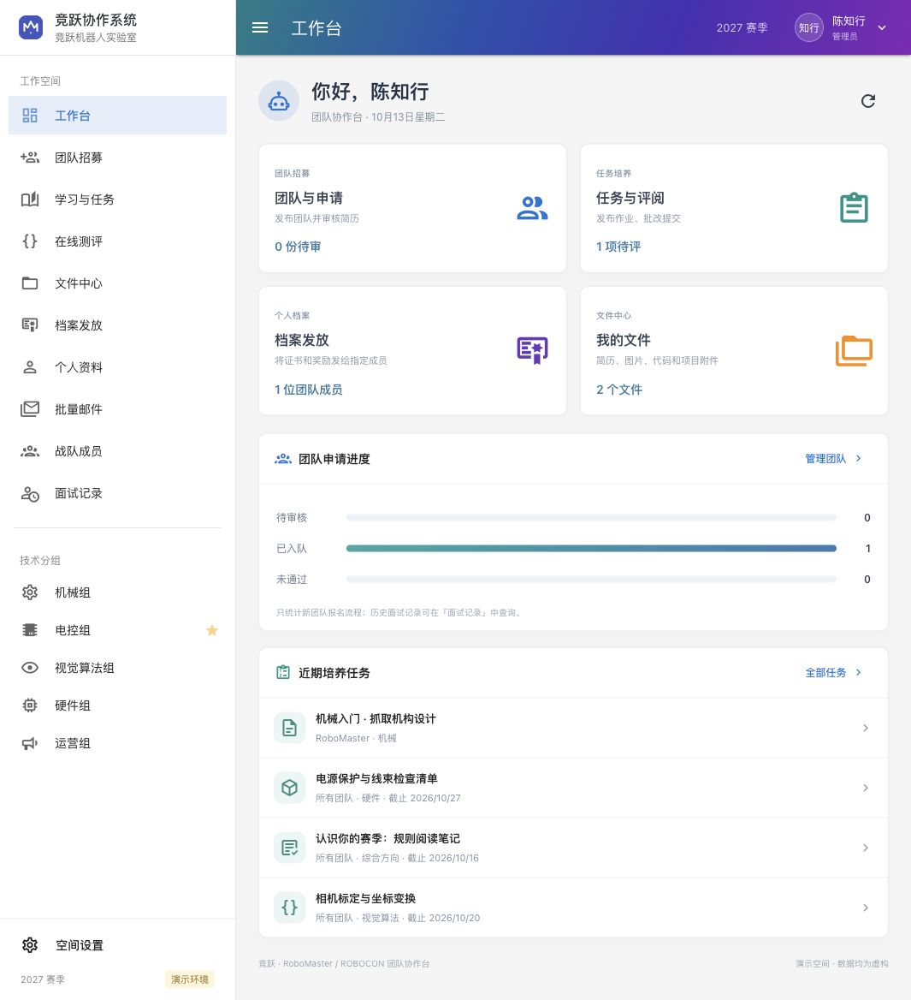

# QUT 机器人战队 · 沧溟 / MOVE 协作平台

**MR System** 是青岛理工大学机器人战队的招新与培养平台。沧溟 / MOVE 是同一支战队的中文与英文名称，同时参与 RoboCon 和 RoboMaster。平台打通「邮箱验证与个人资料 → 团队报名与 PDF 简历 → 审核入队 → 知识库／作业／考试／题库 → 评分与荣誉归档」，并提供讨论区和管理员批量邮件通知。

界面参考[华南虎面试系统演示](https://www.bilibili.com/video/BV1DC4y1f7Fh/)的 Material 布局：青蓝紫渐变顶栏、黄色标签指示线、技术分组侧栏、紧凑人物名单和彩色统计卡。代码与素材独立实现，项目不隶属于上述赛事或华南虎战队。

[](https://github.com/goldenfishs/MR_system/actions/workflows/ci.yml)



另见 [机械组首页](docs/screenshots/qut-mechanical-home.png)、[PDF 知识库预览](docs/screenshots/qut-pdf-preview.png)、[荣誉中心](docs/screenshots/qut-honor-preview.png)、[电控题库](docs/screenshots/qut-code-bank.png)、[手机界面](docs/screenshots/qut-mobile-learning.png)和[界面参考说明](docs/ui-reference.md)。

## 当前功能

- **邮箱注册与资料**：6 位邮箱验证码；姓名、性别、学校、专业、班级、学号、联系电话、照片必填，兴趣爱好选填。已有账号可补全资料。
- **团队报名**：管理员发布同一战队的招募空间与开放方向，成员上传 PDF 简历报名；审核通过后获得相应方向的作业权限。RoboCon 和 RoboMaster 是同一战队的赛事，不分别代表沧溟或 MOVE。历史多团队数据仍可读取。
- **技术组学习**：机械、运营提供首页、知识库、作业和考试；电控、视觉算法、硬件另有编程题库。知识库收录文件、PDF 和视频资料；考试可定时开放。作业中处理各组的文件、工程与代码考核。
- **讨论区**：学员可向指定技术组提问，提问默认只对本人、管理员和导师可见；工作人员回复并标记已解答后，管理员可将重要问答公开给已登录成员。
- **统一文件能力**：支持文档、图片、源码、压缩包、PCB、Gerber、CAD 等文件；单文件 25 MiB、每人 250 MiB。个人中心保留“我的附件”，知识库、报名与作业均可上传；附件按所有者、收件人及任务权限下载。
- **作业与评分**：管理员／导师发布文字＋附件任务；各组提交文件、完整工程或源码，保留历史版本，评分、反馈、退回修改。
- **在线编译、题库与考试**：通过私有 Judge0 兼容服务执行单文件源码，展示异步评测结果、编译错误与自动分数；支持开始／截止时间、公开与隐藏测试。服务端源码上限 64 KiB，最多 10 个用例。最终人工评分独立保留。运营和机械不提供编程题库。
- **荣誉中心与个人中心**：管理员将面试通过证书、奖状、奖励与通知按人发放；用户查询、下载自己的材料，PNG/JPEG 证书可在线预览。个人中心整合基本资料、个人档案与附件。
- **批量邮件**：选择系统用户，保存草稿、核对后逐人发送，查看每人发送结果并重试明确失败项；收件人互相不可见。「已发送」表示 SMTP 服务已接受邮件，不保证进入收件箱；结果不确定的邮件不会自动重发。
- **工作台与成员**：基于报名流程显示真实统计、成员名册、人员账号和组织设置。管理员可在后台替换平台名称、战队中英文名与赛事，直接上传 PNG/JPEG 标志或配置公开图片地址；旧面试与录取记录保留独立入口。
- **Hydro 入口**：保留已有 Hydro 实例链接，暂不同步账号、题目或成绩。

当前采用单实例部署。SMTP 和独立 Judge0 服务需要自行配置；未配置时界面明确提示，已有账号登录、普通文件作业和人工评分可用。评测代码不会由 Web 服务进程直接执行。当前不含文件在线编辑、压缩包自动构建、完整考试监考／多题试卷、对象存储、多组织权限及物资财务。

具体操作见 [团队工作流程](docs/platform-guide.md)，接口与权限见 [API 契约](docs/api-contract.md)。演示数据均为虚构。

## 本地运行

需要 **Node.js 22 LTS、npm、Go 1.24+**。本地演示使用 SQLite，不需要 Docker 或 PostgreSQL。

```sh
npm --prefix frontend ci
bash scripts/dev.sh
```

打开 <http://localhost:5173>。脚本会构建并启动后端和 Vite；按 `Ctrl+C` 停止。前端代理 `/api` 到 `127.0.0.1:8080`，数据保存在被 Git 忽略的 `data/demo/`。脚本拒绝使用外部 `DATABASE_URL`，避免把演示账号写入现有数据库。

首次下载 Go 模块需要网络。也可以分别启动：

```sh
# 终端 1
cd backend
DEMO_MODE=true SESSION_SECURE=false go run .
```

```sh
# 终端 2（仓库根目录）
npm --prefix frontend run dev
```

演示账号仅在 `DEMO_MODE=true` 时初始化：

| 身份 | 邮箱 | 密码 |
| --- | --- | --- |
| 管理员 | `admin@demo.local` | `DemoAdmin!2026` |
| 导师 | `mentor@demo.local` | `DemoMentor!2026` |
| 面试官 | `interviewer@demo.local` | `DemoInterview!2026` |
| 学员 | `student@demo.local` | `DemoStudent!2026` |

演示与正式部署使用不同数据库。正式模式会拒绝已写入演示标记的数据库，关闭演示开关不会自动删除或迁移演示账号。

新注册必须验证邮箱，包括演示模式。未配置 SMTP 时，已有演示账号仍可登录，注册页会提示邮件服务暂不可用。真实邮箱发送和本地 Mailpit 测试方法见[邮箱注册配置](docs/email-registration.md)。

## 构建与检查

```sh
npm --prefix frontend run typecheck
npm --prefix frontend run build
cd backend
go vet ./...
go test ./...
CGO_ENABLED=0 go build -o mr-system .
```

在 `backend/` 目录运行后端时，默认从 `../frontend/dist` 提供构建后的前端。开发脚本和 Docker 已显式设置 `WEB_DIR`。GitHub Actions 执行前后端的检查与构建，使用临时 PostgreSQL 17 服务运行集成测试，并构建容器镜像（不发布）；上述命令也是本地验证入口。

本地真实 HTTP 闭环与重启持久化检查见 [验收记录](docs/verification.md)。

## Docker Compose 部署

仓库提供单实例 Go 服务 + 静态前端 + PostgreSQL 17 的部署定义；当前不要运行共享数据库的多个应用副本。需要 Docker Compose v2，并在应用前配置同域的 HTTPS 反向代理。首次启动：

```sh
cp .env.example .env
openssl rand -hex 24
# 编辑 .env：填写数据库密码、管理员邮箱与 12–72 字节管理员强密码。
# POSTGRES_PASSWORD 使用上一步生成的十六进制字符串。
# 启用公开注册还需填写 SMTP_HOST、SMTP_FROM 及邮件服务商的认证配置。
docker compose up --build -d
docker compose logs -f app
```

应用默认只绑定宿主机 `127.0.0.1:8080`，数据库不映射外部端口。将 HTTPS 反向代理转发到该地址，并保留原始 `Host`；如代理会改写 `Host`，设置 `PUBLIC_ORIGIN=https://你的域名`。`SESSION_SECURE=true` 要求浏览器通过 HTTPS 访问，直接用 HTTP 登录不能正常保持会话。

此 Compose 定义不会部署邮件服务器或 Judge0。邮箱验证和批量邮件共用所配置的真实 SMTP 服务。启用在线编译时，另行部署独立的私有 Judge0 兼容服务，将应用容器可访问的地址填写到 `JUDGE_URL`，并按服务配置填写 `JUDGE_TOKEN`；服务地址与令牌仅供后端使用。容器中的 `localhost` 指应用容器自身，不能用它连接宿主机或另一个容器中的判题服务。当前本地验收只验证了 Judge0 协议，真实编译与沙箱部署尚需在该执行服务上验收，详见[验收记录](docs/verification.md)。

Compose 强制关闭演示模式，要求显式提供管理员和数据库凭据。管理员变量用于首次引导，不能代替账号管理或密码轮换。首次登录后在「空间设置」配置品牌与赛事，在「团队报名」发布招募空间与截止时间，在成员管理中创建导师与面试官账号。设置页的历史报名开关只控制旧面试流程。工作人员使用独立邮箱与 12–72 字节密码，已有注册账号暂不支持直接修改角色。数据库密码会嵌入连接 URI，因此此部署定义要求使用 URL 安全字符，推荐十六进制随机值。请勿提交 `.env`。

PostgreSQL 数据存于 `postgres_data` 卷，上传文件存于 `app_data` 卷的 `/app/data/uploads`；发布新版本前同时备份数据库与上传文件，避免使用 `docker compose down -v` 删除持久化数据。项目尚未提供自动备份、自助改密、邮件找回密码和版本化数据库回滚工具。登录／注册已有基础限流；通过反向代理部署时，应按实际访问规模配置代理限流并验证备份恢复流程。

## 配置

| 变量 | 说明 | 默认值 |
| --- | --- | --- |
| `ADDR` | 后端监听地址 | `127.0.0.1:8080` |
| `DATABASE_URL` | PostgreSQL 连接 URI；为空时使用 SQLite | 空 |
| `DATA_DIR` | SQLite 数据目录 | `./data` |
| `UPLOAD_DIR` | 私有上传文件目录，需随数据库一起备份 | `DATA_DIR/uploads` |
| `JUDGE_URL` | 私有 Judge0 兼容服务地址，为空时禁用在线评测 | 空 |
| `JUDGE_TOKEN` | 服务端发送的 `X-Auth-Token`，不暴露给浏览器 | 空 |
| `WEB_DIR` | 构建后的前端目录 | `../frontend/dist` |
| `DEMO_MODE` | 初始化虚构账号与示例数据，仅供本地演示 | `false` |
| `ADMIN_EMAIL` | 正式环境初始管理员邮箱 | 空 |
| `ADMIN_PASSWORD` | 正式环境初始管理员密码 | 空 |
| `ADMIN_NAME` | 初始管理员显示名 | `管理员` |
| `SESSION_SECURE` | Cookie 是否仅通过 HTTPS 发送 | 本地 `false`；部署定义设置为 `true` |
| `PUBLIC_ORIGIN` | 允许的公开来源，例如 `https://team.example.com` | 空，使用同源校验 |
| `SMTP_HOST` | 邮件服务地址；留空时关闭公开注册和批量邮件发送 | 空 |
| `SMTP_PORT` | 邮件服务端口，通常 STARTTLS 用 587、TLS 用 465 | `587` |
| `SMTP_SECURITY` | `starttls` 或 `tls`，严格校验证书 | `starttls` |
| `SMTP_USERNAME` / `SMTP_PASSWORD` | 服务商 SMTP 用户名与授权密码 | 空 |
| `SMTP_FROM` / `SMTP_FROM_NAME` | 经服务商授权的发件邮箱 / 显示名 | 空 / `QUT机器人战队` |

## 结构与协作

```text
frontend/            Vue 3 + TypeScript + Vuetify + Vite
backend/             Go HTTP API、认证、业务校验与持久化
docs/api-contract.md 接口与角色约定
docs/architecture.md 架构、数据边界与部署说明
docs/roadmap.md      后续里程碑
scripts/dev.sh       本地演示启动脚本
```

欢迎提交 Issue 和 Pull Request。问题报告请说明版本、复现步骤、预期结果与实际结果，并去除候选人个人信息和凭据。涉及权限、报名状态或提交审核的修改，请附相应后端测试；界面修改请确认桌面与窄屏布局。

本仓库独立代码使用 [MIT 许可证](LICENSE)。第三方依赖保持各自许可证。与 [Hydro](https://github.com/hydro-dev/Hydro) 交互不改变其自身许可要求。

邮箱注册交互参考 [Sub2API](https://github.com/Wei-Shaw/sub2api) 的验证码与重发流程，相关实现独立编写，未复制其源码或素材。
