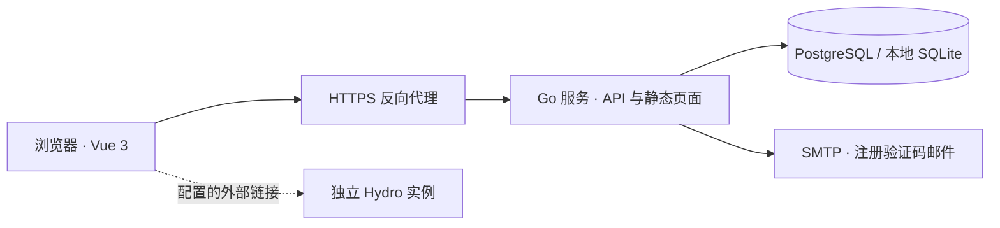

# 架构与边界

MR System 第一版采用模块化单体：一个 Go 服务负责认证、招新、任务、审核和静态前端。开发环境使用 Vite 代理 API；部署时由同一个公开来源提供页面与 API。

## 技术选择

- **Vue 3 / TypeScript / Vuetify / Vite**：延续华南虎系统的 Material 风格与状态队列，独立实现页面。
- **Go HTTP 服务**：统一处理会话、权限、输入校验、业务操作和持久化，减少第一版的部署组件。
- **SQLite**：本地试用和自动化测试；纯 Go 驱动支持不依赖 C 工具链的构建。
- **PostgreSQL**：Docker Compose 的正式部署数据库。
- **Hydro**：第一版只提供入口链接。后续通过插件或接口适配，不直接读写 Hydro 数据库。

## 主要数据

| 对象 | 责任与边界 |
| --- | --- |
| User | 登录身份、角色、已加入的赛队与方向 |
| Email verification | 邮箱绑定的验证码哈希、过期时间、重发冷却、发送与验证次数；成功注册后消费 |
| Applicant | 报名内容、审核状态、面试安排与内部评价；绑定登录用户 |
| Task | 任务内容、类型、所属赛队与方向、截止时间、评分上限 |
| Submission | 每次提交的说明和链接、版本号、审核结果与反馈 |
| Activity | 关键操作记录；面向工作台展示 |
| Settings | 组织与赛季展示、报名开关及截止时间、公告、Hydro 地址 |

报名目前限定为每人一份，未实现独立招新批次实体。录取更新已有用户的赛队和方向，不再创建第二个登录身份。任务提交保留历史版本，只审核最新版本；作品链接由用户维护，系统不托管文件，也不会执行用户提交的代码。

## 权限边界

权限由服务端校验，前端隐藏入口只用于改善操作体验。

| 操作 | 管理员 | 导师 | 面试官 | 学员 |
| --- | --- | --- | --- | --- |
| 查看报名 | 全部 | 全部 | 分配给自己的候选人 | 自己，隐藏内部评分和备注 |
| 最终录取决策 | 是 | 否 | 否 | 否 |
| 面试评分 | 是 | 否 | 已分配候选人 | 否 |
| 发布任务 | 是 | 是 | 否 | 否 |
| 提交任务 | 否 | 否 | 否 | 已录取且匹配赛队／方向 |
| 审核提交 | 是 | 是 | 否 | 否 |
| 创建导师／面试官账号 | 是 | 否 | 否 | 否 |
| 修改系统设置 | 是 | 否 | 否 | 否 |

导师在 MVP 中拥有全队范围的任务和培养视图，未实现组织、赛队、方向三级的细粒度管理范围。管理员可以创建新的导师和面试官账号，不能通过此入口创建管理员或直接提升已有学员的角色。完整请求与返回值见 [接口契约](api-contract.md)。

## 会话与数据处理

登录采用服务端会话及 HttpOnly、SameSite=Lax Cookie；正式环境通过 `SESSION_SECURE=true` 仅在 HTTPS 上发送。修改请求校验 `Origin`（请求提供时），不开放通配跨域。前后端部署在相同来源，避免跨站 Cookie 与额外 CORS 配置。

公开注册必须完成 SMTP 邮箱验证；验证码哈希、冷却和邮箱限额保存在数据库，无需 Redis。消费验证码、创建用户和注册会话位于同一事务中。密码只留在页面内存，SMTP 密钥只通过部署环境注入。邮件配置不可用时保留既有登录，停止新注册。详细规则见[邮箱注册配置](email-registration.md)。

用户身份从会话获取，不信任报名或提交正文中伪造的用户 ID。服务端检查报名开放时间、允许修改的状态、任务截止时间、评分范围、提交版本以及角色权限。客户端保存、提交或审核成功后，再更新界面；接口错误应保持可见并允许纠正。

公开仓库仅包含虚构示例，不包含真实成员资料、数据库或部署密钥。演示账号只用于隔离的演示数据库；演示模式拒绝向非空正式数据库植入账号，正式模式也拒绝启动带演示标记的数据库。修改 `DEMO_MODE` 不会自动清理已有账号，正式实例应从空数据库引导。

## 部署与运维

第一版采用单实例部署，写操作在进程内串行化；不要运行共享数据库的多个应用副本。Docker 多阶段构建先产出 Vite 静态页面，再构建 Go 二进制，最终以非 root 用户运行。Compose 将应用端口绑定到宿主机回环地址，PostgreSQL 只在容器网络中可见。`/api/health` 检查进程响应及数据库连接，不能代替完整业务和备份恢复检查。

外部 HTTPS 反向代理负责证书和 TLS。应保留原始 `Host`，或将 `PUBLIC_ORIGIN` 设置为准确的公开来源。管理员环境变量负责首次引导；修改这些变量不应被当成常规密码修改机制。

登录和注册按直接连接来源 IP 与邮箱组合实施基础限流，成功后清除该组合的计数。正式使用仍需根据部署环境安排数据库备份与恢复验证、日志保留、代理层限流、邮件找回密码和监控。当前数据库初始化适用于 MVP，不提供跨版本迁移回滚保证。

## 后续扩展方式

1. 引入招新批次与赛季实体，先完成历史隔离，再实现年度复制。
2. 引入资源范围授权与批量分配，支撑多赛队和多方向导师。
3. 建立 Hydro 用户映射、测评关联与可重试成绩同步，记录来源与同步时间。
4. 增加对象存储上传及访问控制，之后扩展项目、机器人、子系统和工程档案。

上述能力进入实现前，应先完善相应的数据模型、失败恢复路径和验收条件，不将入口链接或静态展示视为已完成集成。
