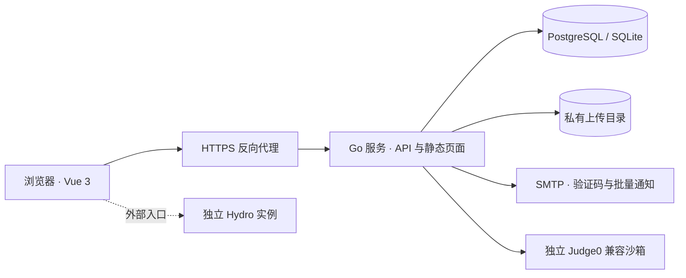

# 架构与边界

MR System 采用模块化单体：一个 Go 服务负责身份、资料、团队报名、任务、文件、个人档案、邮件队列与静态前端。开发环境使用 Vite 代理 API；部署时由同一公开来源提供页面与 API。代码编译由独立 Judge0 兼容服务执行。

## 技术与模块

- **Vue 3 / TypeScript / Vuetify / Vite**：参考华南虎系统的 Material 布局，界面与组件独立实现。
- **Go HTTP 服务**：统一会话、服务端权限、输入校验、数据库事务和附件访问。SQLite 用于本地试用，PostgreSQL 用于正式部署。
- **私有文件目录**：保存随机 ID 命名的二进制内容；数据库保存归属、名称、类型、大小和共享权限。上传路径不通过静态 Web 目录公开。
- **SMTP**：注册验证码与管理员发起的批量通知共用部署配置。异步逐人发送，结果持久化，不阻塞普通写操作。
- **Judge0 兼容接口**：启用后提供单文件代码的编译、运行和用例评分。隔离沙箱单独部署，不允许 Web 进程直接执行代码。
- **Hydro**：仍是独立外部入口，没有单点登录、自动建号或成绩同步。Judge0 适配不代表已经与 Hydro 集成。

## 数据模型

| 对象 | 责任与边界 |
| --- | --- |
| User | 登录身份、角色和历史面试赛事／方向；不直接承载完整个人资料 |
| Profile | 姓名、性别、学校、专业、班级、学号、电话、选填兴趣及本人照片 |
| Email verification | 验证码哈希、有效期、重发冷却、发送和校验次数 |
| FileAsset / file_grants | 文件归属、元数据和指定用户下载权限；文件路径不对外暴露 |
| Team / TeamApplication | 管理员发布的团队、开放方向／时间、本人 PDF 简历与申请状态 |
| Membership | 用户与团队的多对多关系，记录方向和入队时间 |
| Record | 指定用户的奖状、奖励、通知及附件，统一查询个人档案 |
| Task / Submission | 团队／方向任务、教材、提交形式、考试时间、不可变提交版本、人工评分和反馈 |
| JudgeRun | 源代码文件与哈希、语言、逐用例结果、机器分数和运行状态 |
| MailCampaign | 草稿、收件人快照、逐人投递状态及失败／不确定结果 |
| Applicant | 保留原有面试报名、面试时间及内部评价，独立于新团队报名 |
| Activity / Settings | 工作台事件、组织信息、旧报名配置、公告和 Hydro 入口 |

数据库迁移 v1 为原有业务，v2 为邮箱验证，v3 为资料、文件、团队、个人档案、邮件和判题。新表与原有表并存，不伪造旧用户资料，不覆盖旧报名数据。旧账号照常登录，完成个人资料后才能提交新团队报名。

团队申请每用户每团队一份；拒绝后可重新申请，已录取不能自行修改。录取与 Membership 写入在同一事务完成，撤销录取删除对应关系。一个身份可加入多个团队。新任务使用 `teamId` 指向发布的团队；不含 `teamId` 的历史任务继续按原录取、赛事与方向授权。

## 关键业务流程

注册填写必填资料并提供照片、完成邮箱验证码，随后创建账号并自动登录。照片仅通过该注册请求提交，不开放匿名预上传。用户、资料、照片元数据、验证码消费与初始会话同一事务提交，失败后清理照片文件。

管理员发布团队，用户上传 PDF 简历并报名。管理员查看完整资料与简历后接受或拒绝；录取后，成员能读取并提交所属团队与方向的任务。机械文档和 ZIP、硬件 PCB、运营图片等使用统一文件机制；提交历史不覆盖，只审核最新版本。

管理员上传奖状等文件并创建指定用户的 Record，记录和文件授权同一事务写入。接收人可在个人档案中查询、下载，其他普通用户不可访问。此操作不隐式发邮件，需要发送时由管理员在邮件页面创建、确认发送批次。

代码任务可启用测试用例，学生上传单个源文件，选语言后异步判题，前端轮询结果。正式提交绑定本任务、本人、已完成运行和相同源文件哈希，防止拿他人或旧文件结果冒用。自动分数供参考，最终成绩由管理员／导师审核。工程压缩包仅上传和人工评分，不解压编译；普通问答题的自动判分不在本版范围内。

## 权限

权限以服务端为准。个人资料默认本人和需要审核的管理员可见，不向普通成员暴露用户列表。所有附件下载和元数据读取共用权限判断，隐藏 URL 不能替代访问控制。

| 操作 | 管理员 | 导师 | 面试官 | 学员 |
| --- | --- | --- | --- | --- |
| 发布团队、审核新报名 | 是 | 否 | 否 | 否 |
| 新团队报名／简历 | 全部可审查 | 仅本人记录 | 仅本人记录 | 仅自己；资料完整后报名 |
| 发布任务、人工评分 | 是 | 是 | 否 | 否 |
| 提交任务、在线判题 | 否 | 否 | 否 | 已加入对应团队／方向，且在允许时间内 |
| 上传个人文件 | 是 | 是 | 是 | 是 |
| 发放个人档案／批量邮件 | 是 | 否 | 否 | 否 |
| 查看个人档案 | 全部 | 自己 | 自己 | 自己 |
| 创建工作人员、修改设置 | 是 | 否 | 否 | 否 |
| 原有面试评分 | 是 | 否 | 已分配候选人 | 否 |

导师仍拥有全队任务与培养视图，尚未实现多组织、团队管理员和导师逐队授权。任务材料按当前成员关系动态授权，撤销录取后不能继续访问；提交成果仅本人和管理员／导师可访问。个人档案共享通过 `file_grants` 指定收件人。文件所有者和管理员始终可下载文件。

## 文件与个人信息

单文件最大 25 MiB，每用户累计 250 MiB；注册照片最大 2 MiB。上传格式使用白名单，PDF 检查文件头，JPEG/PNG 解码并重新编码以去除 EXIF 等元数据和附加内容，同时限制尺寸和像素总数。SVG 等可能携带脚本的格式只能作为附件下载。全部下载使用 `nosniff`、限制性 CSP，只有清洗后的 JPEG/PNG 支持 inline 预览。

文件不会自动解压、执行或进行杀毒扫描。服务端不把客户端文件名用作磁盘路径；上传目录中的文件使用随机 ID，外部只能通过带会话权限检查的 API 访问。当前采用本地文件存储，没有对象存储、文件删除与保留期管理接口。数据库和上传目录需一起备份，恢复时也必须保持对应关系。进程异常退出可能留下尚未提交元数据的孤立文件，需要运维清理；正常请求失败会清理新照片。

## 邮件与判题作业

批量邮件先保存草稿，再由管理员明确发出，每批最多 200 人。每封只包含一位收件人，其他人的邮箱不会进入收件头。投递进度逐人写入数据库；明确失败可重试，不能确定是否已被 SMTP 接收的邮件标记 unknown，避免自动重复发出。重启后，正在发出的邮件转 unknown，尚未尝试的转 failed；管理员核对后处理。SMTP 接受投递不保证邮件进入收件箱，系统没有送达回执。

配置 `JUDGE_URL` 和可选 `JUDGE_TOKEN` 后连接独立 Judge0 兼容服务。每项任务最多 10 个用例，源代码上限 64 KiB，CPU 时限 0.1–5 秒；请求显式禁用网络、限制内存、墙钟时间和进程数。每用户每分钟最多提交 5 次，Web 进程最多同时处理 2 个判题请求。非管理员无法读取隐藏用例的运行输出，学生任务响应不包含隐藏输入和预期输出。

沙箱限制最终由独立判题服务及其运行环境执行，必须单独维护隔离、资源限制和更新。这里提供协议适配，不随应用自动安装 Judge0，也不会在未配置时显示虚假通过结果。重启时未完成判题标记 error，学生可重新提交。当前作业使用进程内工作线程和数据库状态，适用于单实例；没有分布式队列。

## 会话、部署与运维

登录使用服务端会话及 HttpOnly、SameSite=Lax Cookie；正式环境设置 `SESSION_SECURE=true`。修改请求校验提供的 Origin，不开放通配 CORS。反向代理保留 Host，或设置准确的 `PUBLIC_ORIGIN`。普通 JSON 请求上限 1 MiB，资料／注册 4 MiB，multipart 请求 26 MiB；反向代理的请求体与超时限制需与上传大小匹配。

`UPLOAD_DIR` 默认 `DATA_DIR/uploads`，必须可写且持久化。数据库连接使用 `DATABASE_URL`；留空使用 DATA_DIR 下的 SQLite。SMTP 密钥和判题令牌只通过环境注入，API 不返回凭据。未配置 SMTP 时停止新注册与批量发送，已有登录继续使用；未配置判题服务时保留一般任务文件提交功能。

当前部署为单实例：常规写操作在进程内串行化，异步邮件和判题有各自状态保护；不能运行共享数据库的多个应用副本。Docker 以非 root 用户运行，前端静态资源打包进入镜像。`/api/health` 只检查服务和数据库，不能替代 SMTP、判题服务、文件持久化和备份恢复检查。

公开仓库只包含虚构示例，不包含真实成员数据、上传文件或密钥。演示账号限定独立演示数据库；正式环境应从空数据库引导。变更 DEMO_MODE 不会清理数据，修改管理员引导环境变量不是常规改密码方式。上线还需根据实际负载配置代理限流、监控和备份，密码找回、文件扫描和细粒度管理范围尚未实现。完整请求与响应见[接口契约](api-contract.md)。
