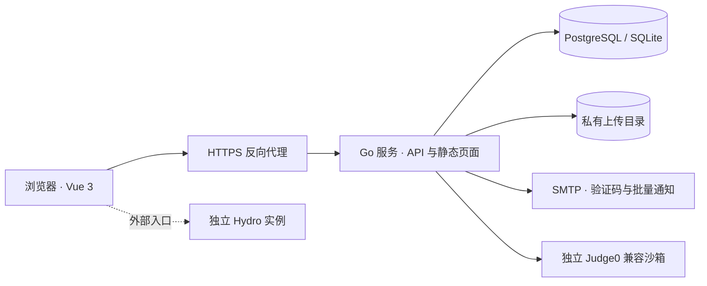

# 架构与边界

MR System 采用模块化单体：一个 Go 服务负责身份、资料、团队报名、任务、知识库、讨论、文件、荣誉与个人档案、邮件队列与静态前端。开发环境使用 Vite 代理 API；部署时由同一公开来源提供页面与 API。代码编译由独立 Judge0 兼容服务执行。

## 技术与模块

- **Vue 3 / TypeScript / Vuetify / Vite**：参考华南虎系统的 Material 布局，界面与组件独立实现。
- **Go HTTP 服务**：统一会话、服务端权限、输入校验、数据库事务和附件访问。SQLite 用于本地试用，PostgreSQL 用于正式部署。
- **私有文件目录**：保存随机 ID 命名的二进制内容；数据库保存归属、名称、类型、大小和共享权限。上传路径不通过静态 Web 目录公开。
- **SMTP**：注册验证码与管理员发起的批量通知共用部署配置。异步逐人发送，结果持久化，不阻塞普通写操作。
- **Judge0 兼容接口**：启用后提供单文件代码的编译、运行和用例评分。隔离沙箱单独部署，不允许 Web 进程直接执行代码。
- **Hydro**：仍是独立外部入口，没有单点登录、自动建号或成绩同步。Judge0 适配不代表已经与 Hydro 集成。

## 数据模型

| 对象 | 责任与边界 |
| --- | --- |
| User | 登录身份、管理员／组管理员角色、正式／梯队／新生身份、各组管理权限和历史面试赛事／方向；不直接承载完整个人资料 |
| Profile | 姓名、性别、学校、专业、班级、学号、电话、选填兴趣及本人照片 |
| Email verification | 验证码哈希、有效期、重发冷却、发送和校验次数 |
| FileAsset / file_grants | 文件归属、元数据和指定用户下载权限；文件路径不对外暴露 |
| Team / TeamApplication | 管理员发布的团队、开放方向／时间、本人 PDF 简历与申请状态 |
| Membership | 用户与团队的多对多关系，记录方向和入队时间 |
| TrainingPlan | 团队／组别培养方案，按序排列 1–12 个阶段，只有最后阶段为最终考核 |
| TrainingProgress / Decision | 每次录取的独立培养周期、阶段方案快照、当前阶段、通过／淘汰及确认人／时间／反馈 |
| Record | 指定用户的奖状、奖励、通知及附件，统一查询个人档案 |
| KnowledgeResource | 各组与共享知识库，PDF、视频、文件和外链；基于有效引用的文件授权 |
| Discussion / Reply | 私问、指定组答疑及管理员公开精选；默认作者和管理者可见 |
| Task / Submission | 团队／方向任务、教材、提交形式、考试时间、不可变提交版本、人工评分和反馈 |
| JudgeRun | 源代码文件与哈希、语言、逐用例结果、机器分数和运行状态 |
| MailCampaign | 草稿、收件人快照、逐人投递状态及失败／不确定结果 |
| Applicant | 保留原有面试报名、面试时间及内部评价，独立于新团队报名 |
| Activity / Settings | 工作台事件、组织信息、旧报名配置、公告和 Hydro 入口 |

数据库迁移 v1 为原有业务，v2 为邮箱验证，v3 为资料、文件、团队、个人档案、邮件和判题，v4 为知识库、讨论、任务分类与 QUT 品牌配置，v5 为角色与各组授权，v6 为培养方案、周期与阶段决策。旧导师迁为原方向的组管理员，授 tasks／knowledge／discussions／members；旧面试官迁为原方向组管理员，授 recruitment／discussions。assessment 独立分配，不因旧组管理员角色自动授予。旧学员均迁为新生，包括已有 accepted 报名的人员，不据此认定新生考核已通过。新表与原有表并存，不伪造旧用户资料，不覆盖旧报名数据。旧账号照常登录，完成个人资料后才能提交新团队报名。

团队申请每用户每团队一份；拒绝后可重新申请，已录取不能自行修改。录取、Membership 与新生培养周期在同一事务完成，撤销录取删除对应关系。默认沧溟 / MOVE 为同一支青岛理工大学机器人战队，Team.competitions 同时包含 RoboCon、RoboMaster；不会按赛事自动拆队。平台仍可支持管理员建立不同招募批次，一个身份可加入多个团队；新生同时仅推进一个培养周期，换团队或组别须先结束当前培养。学习浏览跨组开放，任务提交按成员方向；新生还需加入任务指定的团队，正式／梯队人员可按已记录成员方向提交。新任务使用 teamId 指向发布的团队，历史任务不含 teamId 时仍按成员方向校验。

## 关键业务流程

注册只提交邮箱、密码和邮箱验证码，随后创建新生账号并自动登录。用户、空资料记录、验证码消费与初始会话同一事务提交；未填写的资料不以演示数据或默认学校替代。照片在登录后的个人中心随完整资料提交，不开放匿名预上传。登录后资料未完整时提醒用户前往个人中心；提醒不代替报名接口的完整资料校验。

管理员发布团队，用户上传 PDF 简历并报名。管理员或对应组有报名权限的组管理员查看完整资料与简历后接受或拒绝；录取后仍为新生，开始阶段培养，可跨组阅读学习内容，并按所属团队与方向提交任务。机械文档和 ZIP、硬件 PCB、运营图片等使用统一文件机制；提交历史不覆盖，只审核最新版本。

培养计划按团队和技术组配置，录取时按团队组方案、组通用方案、默认三阶段依次选择，周期固定保存完整快照。默认阶段为基础学习、阶段考核、最终考核。管理者确认通过后只进入下个阶段，最终阶段通过才晋升梯队或正式队员；每次阶段决策记录阶段名称、确认人、时间、反馈和最终身份。只能处理最新周期的当前阶段，前置阶段必须全部通过，且本人仍具备该周期团队／方向的录取关系，不能重复决定、跳阶段或通过直接修改身份提前晋升。撤销录取保留周期及既有结果，阻止后续阶段确认；恢复同团队、方向的 accepted 后可继续尚未淘汰的当前周期。批量决定使用同一事务，任一人员越权或状态失效时全部回滚。

任一阶段淘汰保留培养和学习历史，移除全部团队关系；最新周期的淘汰对新生全局生效，旧 accepted 申请不能恢复学习与提交。重开须明确传 reopenTraining，且操作者具备原培养组和新方向的考核权限，开启新的递增周期；仅报名审核权限无法绕过。既有周期不受计划编辑影响，旧淘汰决策也不会被重开覆盖。成员本人仍可查看全部培养历史、个人荣誉及本人附件。已分配组管理职责的新生被淘汰后保留明确的管理授权，但成员学习／提交资格仍关闭。

管理员上传奖状等文件并创建指定用户的 Record，记录和文件授权同一事务写入。接收人可在荣誉中心查询、预览 PNG 证书和下载；个人中心合并资料、档案与本人附件，其他普通用户不可访问。此操作不隐式发邮件，需要发送时由管理员在邮件页面创建、确认发送批次。

代码任务可启用测试用例，成员上传单个源文件，选语言后异步判题，前端轮询结果。正式提交绑定本任务、本人、已完成运行和相同源文件哈希，防止拿他人或旧文件结果冒用。自动分数供参考，最终成绩由管理员或对应组有任务权限的组管理员审核。工程压缩包仅上传和人工评分，不解压编译；普通问答题的自动判分不在本版范围内。

定时考试在开考前只向普通用户返回标题和时间，不返回正文、资料链接、附件 ID 和测试配置。附件元数据、下载、预览同样检查开考时间。开始后自动放出内容，截止后服务端拒绝提交与判题。已有提交或评测记录的题目禁止直接编辑／删除，避免题目和成绩错配。

新生通过报名审核后才开放技术分组、知识库、作业、题库和考试，人员身份仍为新生；完成新生考核后再晋升梯队或正式队员。获得学习资格后可查看全部组的学习内容，任务提交仍受本人团队／方向限制。知识库的技术组为分类维度，附件同步校验当前入队资格与有效资料引用；撤销入队资格或移除引用会收回相应访问权。知识库由管理员或对应组有知识库权限者管理。讨论继续面向已登录用户，私问默认只有本人、管理员和对应组有讨论权限者可见；有权限的管理者可将已有答复的问题公开为精选，公开后回复冻结，防止未经审核的新内容直接展示。

## 权限

权限以服务端为准。个人资料默认本人及有对应成员／报名权限的管理者可见，不向普通成员暴露用户列表。仅有邮件或荣誉权限的选人列表收敛为姓名、邮箱、所属组，荣誉额外保留学号；完整照片、电话、专业、班级、兴趣与考核说明仍需独立成员／报名权限。所有附件下载和元数据读取共用权限判断，隐藏 URL 不能替代访问控制。

| 操作 | 管理员 | 组管理员 | 正式／梯队队员／新生 |
| --- | --- | --- | --- |
| 发布团队、修改平台设置 | 全部 | 否 | 否 |
| 审核报名及历史面试 | 全部 | 对应组 recruitment 权限 | 仅查看自己 |
| 培养阶段、淘汰与最终晋升 | 全部 | 对应组 assessment 权限 | 仅查看本人进度 |
| 发布／编辑任务、考试与评分 | 全部 | 对应组 tasks 权限 | 否 |
| 管理知识库 | 全部 | 对应组 knowledge 权限 | 否 |
| 私问答疑、解答及公开精选 | 全部 | 对应组 discussions 权限 | 本人提问和回复 |
| 查看学习内容 | 全部组 | 按人员身份和录取资格判断；未录取或淘汰新生仅保留授权管理操作 | 正式／梯队全部组；新生入队审核通过且未淘汰后全部组 |
| 提交任务、在线判题 | 按本人所属方向与时间规则 | 按本人所属方向与时间规则；淘汰新生禁止成员提交 | 按本人所属方向与时间规则；新生须未淘汰且加入指定团队 |
| 查看成员名单 | 全部 | 对应组 members 权限 | 否 |
| 荣誉发放／批量邮件 | 全部 | 接收人所属组 records／mail 权限 | 否 |
| 查看个人档案 | 全部 | 对应组 records 权限及本人 | 本人 |
| 创建账号、分配角色和权限 | 全部 | 否 | 否 |
| 上传个人文件 | 是 | 是 | 是 |

角色为 admin、group_admin、member、reserve、freshman；memberType 单独记录 formal、reserve、freshman。管理员或组管理员可保留其队员身份，groupGrants 数组按方向分别列出权限，兼任时添加多条。仅总管理员可创建账号、分配管理角色、方向与组授权，不能降级最后一位管理员。组管理员的 assessment 权限仅允许确认本组培养阶段和最终新生身份，不能转授权限、同时改角色或跨组确认；不能确认自己的考核。机械、电控、硬件、视觉算法、运营的模块权限独立，不把组管理员等同全平台工作人员。

报名 accepted 只开放学习资格和相应团队关系，不提升人员身份。培养按阶段推进，管理员或对应组有 assessment 权限的组管理员对当前阶段明确确认通过或淘汰；只有所有前置阶段通过后才能确认最终考核，并选择梯队或正式队员身份。最终通过保留 assessmentPassedAt、assessmentConfirmedBy 和选填 assessmentNote；确认代表管理者的最终人工核定，不根据单次作业分数自动晋升。没有阶段周期的存量新生可由管理员或所属组有考核权限者在身份接口明确确认最终考核，不为旧报名伪造阶段结果；已有培养周期人员必须使用阶段接口。后台创建既有正式／梯队账号时可直接设置身份，便于录入存量人员。

跨组学习只开放学习内容和材料，不开放他人提交、未公开私问、人员照片／简历、隐藏测试或档案。管理 API、文件元数据／下载／预览、统计与判题记录都以当前模块和方向授权校验；不能凭旧发布人、已有链接或旧会话继续管理已撤销授权的内容。个人档案共享通过 `file_grants` 指定收件人，本人附件和明确发给本人的荣誉在失去学习资格后保留。文件所有者和管理员始终可下载文件。

## 文件与个人信息

单文件最大 25 MiB，每用户累计 250 MiB；个人资料照片最大 2 MiB。上传格式使用白名单，PDF 检查文件头，JPEG/PNG 解码并重新编码以去除 EXIF 等元数据和附加内容，同时限制尺寸和像素总数。SVG 等可能携带脚本的格式只能作为附件下载。全部下载使用 `nosniff`、限制性 CSP，清洗后的 JPEG/PNG、PDF、MP4/WebM 支持鉴权 inline 预览，视频支持 Range 请求；SVG 仍仅下载。

文件不会自动解压、执行或进行杀毒扫描。服务端不把客户端文件名用作磁盘路径；上传目录中的文件使用随机 ID，外部只能通过带会话权限检查的 API 访问。当前采用本地文件存储，没有对象存储、文件删除与保留期管理接口。数据库和上传目录需一起备份，恢复时也必须保持对应关系。进程异常退出可能留下尚未提交元数据的孤立文件，需要运维清理；正常请求失败会清理新照片。

## 邮件与判题作业

批量邮件先保存草稿，再由管理员或获授权组管理员明确发出，每批最多 200 人。创建和发送校验全部收件人的当前组别范围，后台每次投递前重新读取实际发起发送者的身份与权限；不能借草稿创建者的权限继续发送。每封只包含一位收件人，其他人的邮箱不会进入收件头。投递进度逐人写入数据库；明确失败可重试，不能确定是否已被 SMTP 接收的邮件标记 unknown，避免自动重复发出。重启后，正在发出的邮件转 unknown，尚未尝试的转 failed；有权管理的人员核对后处理。SMTP 接受投递不保证邮件进入收件箱，系统没有送达回执。

配置 `JUDGE_URL` 和可选 `JUDGE_TOKEN` 后连接独立 Judge0 兼容服务。每项任务最多 10 个用例，源代码上限 64 KiB，CPU 时限 0.1–5 秒；请求显式禁用网络、限制内存、墙钟时间和进程数。每用户每分钟最多提交 5 次，Web 进程最多同时处理 2 个判题请求。非管理员无法读取隐藏用例的运行输出，学生任务响应不包含隐藏输入和预期输出。

沙箱限制最终由独立判题服务及其运行环境执行，必须单独维护隔离、资源限制和更新。这里提供协议适配，不随应用自动安装 Judge0，也不会在未配置时显示虚假通过结果。重启时未完成判题标记 error，学生可重新提交。当前作业使用进程内工作线程和数据库状态，适用于单实例；没有分布式队列。

## 会话、部署与运维

登录使用服务端会话及 HttpOnly、SameSite=Lax Cookie；正式环境设置 `SESSION_SECURE=true`。修改请求校验提供的 Origin，不开放通配 CORS。反向代理保留 Host，或设置准确的 `PUBLIC_ORIGIN`。普通 JSON 请求（含注册）上限 1 MiB，资料／标志更新 4 MiB，multipart 请求 26 MiB；反向代理的请求体与超时限制需与上传大小匹配。

`UPLOAD_DIR` 默认 `DATA_DIR/uploads`，必须可写且持久化。数据库连接使用 `DATABASE_URL`；留空使用 DATA_DIR 下的 SQLite。SMTP 密钥和判题令牌只通过环境注入，API 不返回凭据。未配置 SMTP 时停止新注册与批量发送，已有登录继续使用；未配置判题服务时保留一般任务文件提交功能。

当前部署为单实例：常规写操作在进程内串行化，异步邮件和判题有各自状态保护；不能运行共享数据库的多个应用副本。Docker 以非 root 用户运行，前端静态资源打包进入镜像。`/api/health` 只检查服务和数据库，不能替代 SMTP、判题服务、文件持久化和备份恢复检查。

公开仓库只包含虚构示例，不包含真实成员数据、上传文件或密钥。演示账号限定独立演示数据库；正式环境应从空数据库引导。变更 DEMO_MODE 不会清理数据，修改管理员引导环境变量不是常规改密码方式。上线还需根据实际负载配置代理限流、监控和备份，密码找回、文件扫描和多组织管理范围尚未实现。完整请求与响应见[接口契约](api-contract.md)。
